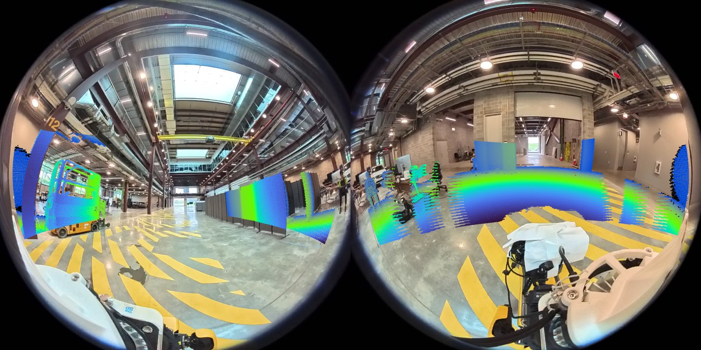

# lidar_camera_fusion

ROS 2 node that paints a LiDAR cloud with the colours of one or two cameras and draws the LiDAR points on the camera
images. It reads the `calib.json` written by
[lidar_camera_calibration](https://github.com/ChenCN22/lidar_camera_calibration)
(format of [koide3/direct_visual_lidar_calibration](https://github.com/koide3/direct_visual_lidar_calibration)), so it
doubles as a live check of that calibration.



## Tested environment

| | |
|---|---|
| OS / ROS | Ubuntu 22.04, ROS 2 Humble, `rmw_fastrtps_cpp` |
| camera models | `plumb_bob`, `fisheye`, `omnidir`, `equirectangular` (the `camera_model` field of `calib.json`) |

## Build
 
```
sudo apt install nlohmann-json3-dev
cd <your_worksapce>/src
git clone https://github.com/ChenCN22/lidar_camera_fusion.git
cd <your_worksapce>
rosdep install --from-paths src -iy 
colcon build --packages-select lidar_camera_fusion
```

## Run

```
ros2 launch lidar_camera_fusion lidar_camera_fusion.launch.py \
    calib_path:=<calib.json> image_topic:=<image topic> cloud_topic:=<cloud topic>
```

A second camera on the same LiDAR is added with `calib_path_back:=<calib.json> image_topic_back:=<image topic>`.
Each point is then given to the camera whose optical axis is closer to it, so the two coloured clouds do not overlap.

| topic | type | content |
|---|---|---|
| `image_topic`, `image_topic_back` | `sensor_msgs/Image` | input images |
| `cloud_topic` | `sensor_msgs/PointCloud2` | input cloud, `x y z` as float32 or float64 |
| `colored_cloud_topic` (`/colored_cloud`), `colored_cloud_topic_back` (`/colored_cloud_back`) | `sensor_msgs/PointCloud2` | points seen by that camera, `x y z rgb`, LiDAR frame, one per input cloud |
| `overlap_image_topic` (`/overlap_image`), `overlap_image_topic_back` (`/overlap_image_back`) | `sensor_msgs/Image` | input image with the LiDAR points drawn on it, coloured by range, one per input image |

| parameter | default | meaning |
|---|---|---|
| `calib_path` | required | `calib.json` of the (first) camera; `results.T_lidar_camera` is used, else `results.init_T_lidar_camera_auto` |
| `calib_path_back` | empty | `calib.json` of the second camera; empty = one camera |
| `image_topic`, `image_topic_back` | `/image`, `/camera_back` | |
| `cloud_topic` | `/ouster/points` | |
| `queue_size` | 3 | each image is paired with the cloud received `queue_size` clouds earlier: set it to image latency x LiDAR rate (3 = 300 ms at 10 Hz). There is no time-stamp matching |
| `image_qos` | `reliable` | `reliable` or `sensor` (best effort); must be compatible with the image publisher |
| `max_distance` | 8.0 | points farther than this (m) are dropped; `<= 0` keeps all |
| `point_radius` | 2 | radius (px) of the points drawn on the overlap image |

Images larger than the Fast-DDS shared-memory segment (512 KB by default) are sent as UDP fragments and frames or clouds
get lost. 

For such images start the camera driver and this node with
`export FASTRTPS_DEFAULT_PROFILES_FILE=<path>/config/fastdds_shm_large.xml`.

This xml is included in `./config/` in this repo.

## Example: Ouster OS-1-128 + Insta360 X4 (two fisheye lenses)

Calibration files in `example/ouster_os1_insta360_x4/` (session 2026-08-20 of the
[calibration example](https://github.com/ChenCN22/lidar_camera_calibration/blob/main/example/ouster_os1_insta360_x4/README.md);
the back lens is the front result composed with the front-to-back lens transform, see the `meta.note` of `calib_back.json`).
Sensor drivers are NOT included in this repo.

```
S=$(ros2 pkg prefix lidar_camera_fusion)/share/lidar_camera_fusion
export FASTRTPS_DEFAULT_PROFILES_FILE=$S/config/fastdds_shm_large.xml      # 1440x1440 bgr8 = 6.2 MB per image
ros2 launch lidar_camera_fusion lidar_camera_fusion.launch.py \
    image_topic:=/camera_front calib_path:=$S/example/ouster_os1_insta360_x4/calib_front.json \
    overlap_image_topic:=/overlap_image_front colored_cloud_topic:=/colored_cloud_front \
    image_topic_back:=/camera_back calib_path_back:=$S/example/ouster_os1_insta360_x4/calib_back.json \
    max_distance:=6.0
```

| | |
|---|---|
| lidar | Ouster OS-1-128, 1024x10, `/ouster/points` at 10 Hz |
| camera | Insta360 X4, two 1440x1440 fisheye images at 30 fps, `omnidir` model |
| `queue_size` | 3 (images arrive about 300 ms after the cloud of the same instant) |
| output, replay of a 31 s bag | both overlap images at 30 Hz, both coloured clouds at 10 Hz, no point in both clouds |

## Licence

MIT (`LICENSE`). The projection functions follow the camera models of koide3/direct_visual_lidar_calibration (MIT).
